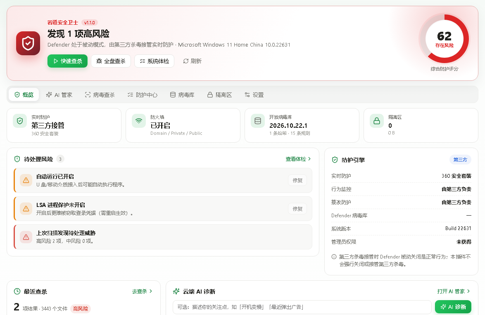
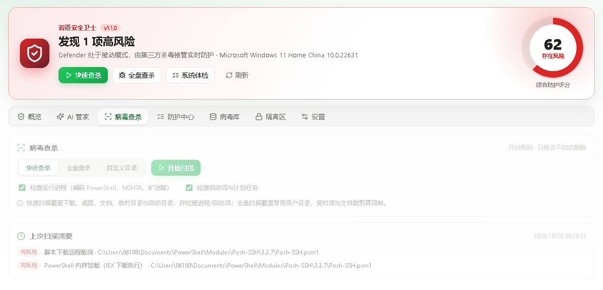
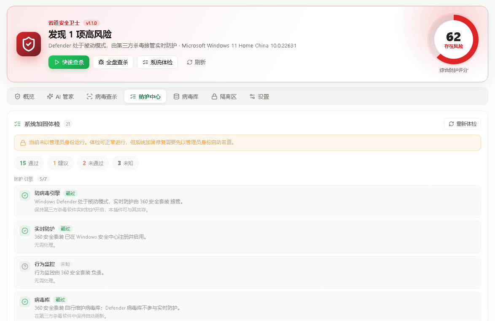
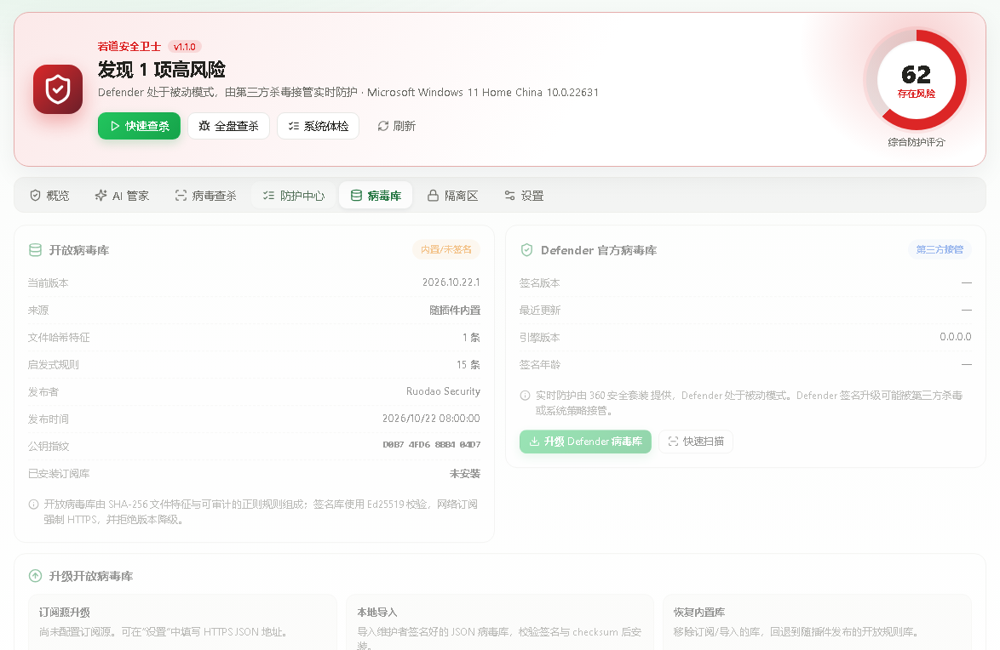
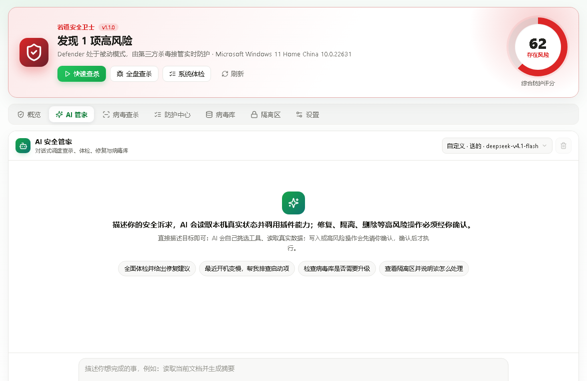

# 若道安全卫士（不装驱动、不驻留后台的安全工作台）

> 电脑的安全状态散落在七八个系统面板里：Defender 在设置里、防火墙在控制面板、启动项在任务管理器、计划任务在另一个角落。想搞清楚"我这台机器到底安不安全"，得来回翻半天，还看不懂。
>
> 若道安全卫士把这些收进一个工作台：**一个 0–100 的防护评分**，下面是逐项明细——防护引擎、网络、系统加固、持久化项，该修的列出可一键修复项。查杀用开放病毒库（SHA-256 + 启发式规则），可疑文件进隔离区而不是直接删；病毒库走 Ed25519 签名校验。**不装内核驱动、不常驻后台、扫描不上传文件。**

**📦 一键安装**：[https://ruodao.com/plugin-market/items/ruodao-guard](https://ruodao.com/plugin-market/items/ruodao-guard)（若道桌面端「功能插件市场」搜索"安全卫士"，或市场页直接「下载 ZIP」用本地安装导入。）

---

## 💎 五个理由

### 🧭 1. 一个评分看清全局

汇总 Defender、防火墙、UAC、SMBv1、自动运行、凭据保护、hosts、代理、病毒库、隔离区与最近扫描，给出 0–100 防护评分。哪项拖后腿，点开就是原因。

### 🧪 2. 开放病毒库，规则看得见

查杀基于 **SHA-256 特征 + 启发式规则**，覆盖文件、进程、启动项、计划任务与 hosts。规则不是黑盒——病毒库是 JSON，可以自己导入、自己审。

### ✍️ 3. 病毒库升级要验签

订阅源升级走 HTTPS 下载，用 **Ed25519 签名 + checksum** 校验后才安装；验不过就不装，并保留原库。也支持导入本地库、一键回退到随插件发布的内置库。

### 🗄️ 4. 隔离而不是删除

查到的文件重新计算哈希后移入隔离区，**不直接删**。确认是误报可以还原到原路径（被占用时追加 `.restored`），确认是威胁再彻底删除。

### 🤖 5. AI 管家：能动手，但高危操作先问你

对话式调度全部能力："看看我电脑有什么风险"、"查一下下载目录"、"把这条隔离记录处理掉"。修复、隔离、删除这类高风险操作，AI 会先弹确认，你不点它不做。另有云端 AI 诊断，把状态与体检结果交给模型分析（**只发状态摘要，不发文件**）。

## 🖼️ 界面预览

| 概览（防护评分） | 病毒查杀 |
| --- | --- |
| [](docs/screenshots/1.png) | [](docs/screenshots/2.png) |

| 防护中心（加固体检） | 病毒库 |
| --- | --- |
| [](docs/screenshots/3.png) | [](docs/screenshots/4.png) |

| AI 管家 |  |
| --- | --- |
| [](docs/screenshots/5.png) |  |

## ✨ 功能总览

| 能力 | 说明 |
| --- | --- |
| 🩺 **环境自检** | PowerShell、管理员权限、数据目录、病毒库签名、Defender 引擎可用性 |
| 📊 **状态与评分** | 十余项安全状态汇总，输出 0–100 分与逐项明细 |
| 🔍 **病毒查杀** | 文件 / 进程 / 启动项 / 计划任务 / hosts；`{ mode: quick\|full\|custom }` |
| 🛡️ **加固体检** | 防护引擎、网络、系统加固、持久化项，返回 pass/warn/fail 与可一键修复项 |
| 🔧 **加固修复** | 只执行白名单内的修复，需管理员权限并显式确认 |
| 🗄️ **隔离区** | 隔离 / 列出 / 还原 / 彻底删除，都带确认 |
| 📚 **病毒库** | 查看当前库与公钥指纹；升级（验签）、导入本地库、回退内置库 |
| 🪟 **Defender 联动** | 升级官方病毒库、触发快速扫描 |
| 🤖 **AI 管家 / 云端诊断** | 对话式调度；云端只分析状态摘要 |

## 📥 安装

1. 下载并安装 [若道桌面端](https://ruodao.com)。
2. 「功能插件市场」→ 搜索 **安全卫士** → 安装。
3. 打开工作台点「环境自检」：会提示是否具备管理员权限（加固修复需要）。

## 🚀 使用教程

### 先看评分，再决定修不修

概览页等评分读完（要查询系统状态，约几秒）→ 看哪几项是红/黄 → 去防护中心看明细与说明。

### 快速体检一次

病毒查杀选「快速」→ 扫常见位置与持久化项 → 有命中就进隔离区 → 逐条确认是误报（还原）还是威胁（彻底删除）。

### 加固修复（谨慎）

防护中心里勾选要修的项 → 点应用 → 插件只执行白名单内的动作，其它一律不动。**建议一次只改一两项并观察系统表现**，尤其是网络与凭据相关设置。

### 更新病毒库

病毒库页签 → 升级开放病毒库（自动验签）→ 失败会自动保留原库。想回退就点「恢复内置病毒库」。

## 🛠️ 二次开发

```
├── plugin.json           # 元信息
├── ruodao-plugin.json    # 核心：id、权限、18 个命令
├── ui.json               # 工作台界面
├── bin/guard.mjs         # 命令入口
├── lib/status.mjs        # 状态采集与评分
├── lib/scanner.mjs       # 查杀引擎（SHA-256 + 启发式）
├── lib/signatures.mjs    # 病毒库加载与验签
├── lib/system.mjs        # 系统加固项检测与修复（白名单）
├── lib/store.mjs         # 隔离区与本地数据
├── lib/agent-core.mjs    # AI 管家循环
├── lib/agent-tools.mjs   # 暴露给 AI 的工具
├── db/public-key.pem     # 病毒库验签公钥
├── db/signatures.json    # 内置病毒库
├── tools/sign-db.mjs     # 病毒库签名工具
└── test/                 # guard.test.mjs / agent.test.mjs
```

```bash
node bin/guard.mjs doctor
node --test test/
```

**加一条启发式规则**：在 `db/signatures.json` 里按现有结构加规则，用 `tools/sign-db.mjs` 重新签名，重启插件生效。

## 🔐 隐私

- 扫描**只在本机进行**，不上传任何文件、文件名或哈希；
- 只有你主动点「云端 AI 诊断」时，才把状态摘要（评分、项目、系统版本）发给模型服务；
- 隔离区文件留在本机数据目录。

## 📦 更新日志

- **v1.1.0**（当前开源版本）：防护评分与十余项状态汇总、开放病毒库（Ed25519 验签）、隔离区、加固体检与白名单修复、AI 管家与云端诊断。

## ⚠️ 说明

这是一个**辅助工具**，不是杀毒引擎的替代品：它读取并联动系统自带防护，配合开放特征库做补充检查。涉及系统设置的修复请逐项确认。

## 🔗 相关

- 插件市场页：[https://ruodao.com/plugin-market/items/ruodao-guard](https://ruodao.com/plugin-market/items/ruodao-guard)
- 若道官网：[https://ruodao.com](https://ruodao.com)
- 更多插件源码：[https://github.com/ruodaoai](https://github.com/ruodaoai)

## License

MIT
